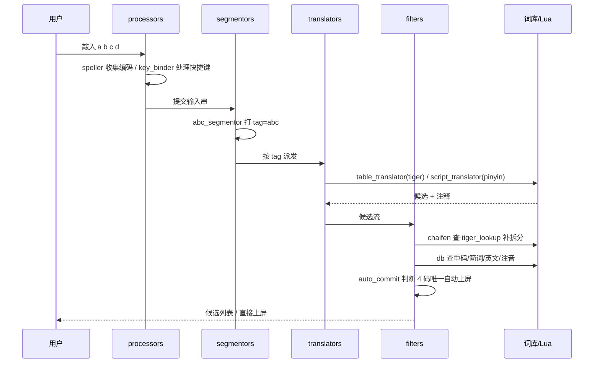
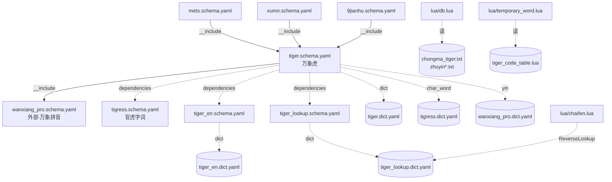

# 01 · 整体架构与运行原理

本篇解释「万象虎」在 Rime 体系中的位置、仓库的分层结构，以及一次按键到候选上屏的完整链路。

---

## 1. Rime 的运行模型

Rime（librime）是一个**配置驱动**的输入法引擎：程序本身不写死任何输入逻辑，所有行为来自**方案（schema）**。一个方案的本质是一张 YAML，它规定了四类组件的执行顺序：

```
processors  →  segmentors  →  translators  →  filters
（处理器）      （分段器）       （翻译器）        （过滤器）
```

| 阶段 | 职责 | 本项目例子 |
|------|------|-----------|
| **processor** | 拦截原始按键事件，可改写输入、触发开关、自动上屏 | `ascii_composer`、`speller`、`key_binder`、`quick_symbol_text2`（重复上屏） |
| **segmentor** | 把输入串切成若干「段」，并打上 `tag`（标记该段该由谁翻译） | `abc_segmentor`、`matcher`、`affix_segmentor@yin_add_user` |
| **translator** | 针对某个 tag 产生候选词 | `table_translator`、`script_translator`、`history_translator`、`switch_translator` |
| **filter** | 对候选流做增删改与排序 | `chaifen`、`db`、`temporary_word`、`auto_commit`、`uniquifier` |

组件既可以由 librime 内置提供，也可以来自 Lua 插件：

```yaml
engine:
  processors:
    - lua_processor@*quick_symbol_text2   # 加载 lua 处理器
  translators:
    - lua_translator@*switch_translator   # 加载 lua 翻译器
  filters:
    - lua_filter@*db                      # 加载 lua 过滤器
```

### `@*` 前缀的含义

- `lua_xxx@name`：直接 `require("name")`，把文件返回的**函数**作为组件入口。
- `lua_xxx@*name`：从 **`rime.lua` 中注册的全局变量**取名（`*` 表示「全局名」）。

本仓库大量使用 `@*name` 形式。这些全局名在**基础工程 `rime.lua`** 中注册（例如 `chaifen = require("chaifen")`），而本仓库只提供对应的 `lua/*.lua` 文件。因此：

> 单独把本仓库放进 Rime 目录**无法工作**——必须与含 `rime.lua` 的基础工程合并。见 [06-部署与运行](06-deployment.md)。

---

## 2. 仓库的分层结构

虽然所有文件平铺在根目录，但逻辑上分为 5 层：

```
┌─────────────────────────────────────────────────────────┐
│ L5  入口配置层                                            │
│     default.yaml / default.custom.yaml                   │
│     决定「启用哪些方案、菜单每页几项、全局快捷键」          │
├─────────────────────────────────────────────────────────┤
│ L4  方案定义层                                            │
│     tiger / mets / xumn / 9jianhu / tigress / tiger_en    │
│     *.schema.yaml  —— 开关、引擎、翻译器参数               │
│     *.custom.yaml  —— 对基础方案的补丁（虎系管线追加处）    │
├─────────────────────────────────────────────────────────┤
│ L3  逻辑扩展层（Lua）                                     │
│     lua/*.lua —— 拆分、简词、重码、文件管理、统计……        │
├─────────────────────────────────────────────────────────┤
│ L2  数据层                                                │
│     *.dict.yaml / cn_dicts_tiger/ / custom_phrase/        │
│     opencc/ / new_symbols.yaml / wxh_algebra.yaml         │
├─────────────────────────────────────────────────────────┤
│ L1  呈现层                                                │
│     万象虎.trime.yaml（同文主题/键盘）、sound/、backgrounds/│
└─────────────────────────────────────────────────────────┘
```

---

## 3. 引擎管线的实际内容

### 3.1 虎系方案（tiger / mets / xumn / 9jianhu）

`tiger.schema.yaml` 第 1 行 `__include: wanxiang_pro.schema.yaml:/`，表示**完整继承**万象拼音方案的配置（包括其 `engine` 管线），然后在其上覆盖虎码相关设置。

管线的「虎码专属追加」写在 [wanxiang_pro.custom.yaml](../wanxiang_pro.custom.yaml) 中（`patch:` 段），可以精确看到插入位置：

```yaml
patch:
  engine/processors/@before0: lua_processor@*quick_symbol_text2      # 最前：重复上屏
  engine/segmentors/@before4: affix_segmentor@yin_add_user           # 音码造词分段
  engine/translators/@before1: lua_translator@*switch_translator     # 多源聚合
  engine/translators/@before6: lua_translator@*set_schema_pro        # 方案切换指令
  engine/translators/+:
    - lua_translator@*wj                 # 文件管理
    - table_translator@tiger_en          # 中英混合
    - script_translator@yin_add_user     # 音码造词
    - history_translator@historyDM       # 重复上屏（电脑）
    - history_translator@historyDM3
    - history_translator@historySJ       # 重复上屏（手机）
  engine/filters/@before6: lua_filter@*db            # 重码/简词/英文/注音
  engine/filters/@before7: lua_filter@*temporary_word # 临时4码简词
  engine/filters/+:
    - lua_filter@*read
    - lua_filter@*auto_commit
    - lua_filter@*chaifen
    - lua_filter@*unicode_display
    - lua_filter@*switch_filter
    - uniquifier
```

> `@beforeN` = 插到第 N 个组件之前；`/ +` = 追加到末尾。这是 Rime **补丁语法**，用于在不改动原方案的前提下增删组件。

### 3.2 九键虎（9jianhu）

`9jianhu.schema.yaml` **自带完整 `engine`**（不依赖外部管线），并显式列出万象提供的高级组件：

```
processors : quick_symbol_text2, super_processor, partial_commit, super_sequence,
             super_tips, ascii_composer, recognizer, key_binder, lua key_binder,
             speller, punctuator, selector, navigator, express_editor
segmentors : ascii_segmentor, matcher, abc_segmentor,
             affix_segmentor@add_user_dict, punct_segmentor, fallback_segmentor
translators: punct_translator, script_translator, shijian, unicode,
             number_translator, super_calculator,
             script_translator@user_dict_set, script_translator@add_user_dict
filters    : temporary_word, chaifen, simplifier@pinyin, unicode_display,
             switch_filter, uniquifier
```

其中 `super_*`、`partial_commit`、`shijian`、`unicode`、`number_translator`、`super_calculator` 均来自基础工程，**本仓库未包含**。

### 3.3 官虎字词（tigress）

`tigress.schema.yaml` 同样自带完整 `engine`，是「纯字词、无整句」的精简方案，用于：
- 作为 `tiger.schema.yaml` 的 `dependencies` / `char_word` 词典来源；
- 独立使用时提供官虎字词输入。

---

## 4. 一次输入的完整数据流

以「在万象虎方案中输入 4 码」为例：



对应到具体模块：
- **重复上屏**：`quick_symbol_text2`（processor）监听 `''`、`'`、`z`、`[`、`]` 等触发。
- **拼音混输**：`switch_translator`（translator）在 `yin` 开关打开时聚合 `yin_engine`。
- **拆分注释**：`chaifen`（filter）用 `ReverseLookup("tiger_lookup")` 把单字展开为部首。
- **重码替换 / 简词 / 英文 / 注音**：`db`（filter）一个模块内聚四套子库。
- **4 码自动上屏**：`auto_commit`（filter）读取 `char_word/*` 配置。

---

## 5. 关键配置的继承与覆盖关系

```
default.yaml
  ├─ schema_list: [tiger, wanxiang_pro, mets, xumn, 9jianhu]
  ├─ menu / switcher / ascii_composer / recognizer / key_binder（全局默认）
  └─ 被各 schema 通过 recognizer: import_preset: default 继承

wanxiang_pro.schema.yaml（外部基础工程，本仓库不含）
  ├─ 定义万象拼音 engine / 词库 / 模型
  ├─ 被 wanxiang_pro.custom.yaml 打补丁（虎系管线追加）
  └─ 被 tiger.schema.yaml __include 继承

tiger.schema.yaml
  ├─ __include: wanxiang_pro.schema.yaml:/
  ├─ 覆盖 switches（虎句/虎词/虎单/音码…）
  ├─ 新增 translator / yin_engine / user_dict_set / add_user_dict / char_word
  └─ dependencies: [tiger_en, tiger_lookup, tigress]

mets.schema.yaml    → __include: tiger.schema:/，改 prism + algebra
xumn.schema.yaml    → __include: tiger.schema:/，改 prism + delimiter + alphabet
9jianhu.schema.yaml → __include: tiger.schema:/，整体重写 engine + 九键 algebra
```

> `__include: xxx:/` 会**递归合并**被引用文件（`:/` 表示取根节点）。子方案只需写差异项。

---

## 6. 依赖关系图



---

## 7. 为什么需要基础工程

仓库中以下引用**在本仓库内找不到**，均由基础工程（rime-wanxiang-tiger-fuzhu / 万象）提供：

| 缺失项 | 用途 | 被谁引用 |
|--------|------|---------|
| `wanxiang_pro.schema.yaml` | 万象拼音方案根配置 + engine | tiger 的 `__include` |
| `rime.lua` | 注册 `*name` 全局组件 | 所有 `lua_*@*name` |
| `wanxiang/wanxiang.lua`、`wanxiang/userdb.lua` | 工具库 / LevelDB 封装 | `db.lua`、`set_schema_pro.lua`、`temporary_word.lua` |
| `shijian`、`unicode`、`number_translator`、`super_calculator` | 时间/Unicode/金额/计算器 | 9jianhu、tigress、万象 |
| `super_processor`、`super_sequence`、`super_tips`、`partial_commit`、`key_binder` | 万象超级处理器族 | 9jianhu、tigress |
| `dicts/*.pro`、`zuci/*` | 万象拼音主词库 | `wanxiang_pro.dict.yaml`、`tiger.dict.yaml` |
| 语言模型（`*.gram` / `.bin`） | 整句组句 | wanxiang_pro 的 translator |

这些正是「本仓库必须与基础工程合并」的根本原因。合并方式见 [06-部署与运行](06-deployment.md)。

---

**下一篇** → [02 · 方案配置详解](02-schemas.md)
