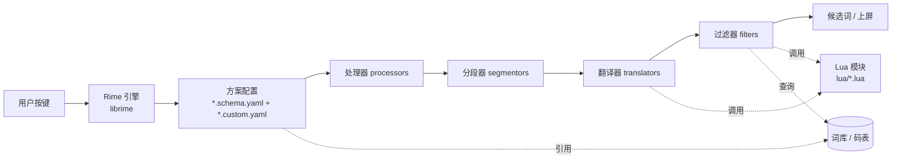

# 万象虎 Code Wiki

> 面向开发者、维护者与高级用户的完整代码/配置说明文档。
> 项目仓库：`github.com/zhhwux/wxzhh`（万象虎 Rime 输入方案）

---

## 1. 项目是什么

**万象虎** 是一套基于 [Rime（中州韵 / librime）](https://github.com/rime/librime) 的**中文输入法方案**，由 [万象方案](https://github.com/amzxyz/rime_wanxiang_pinyin)（优质词库 + 语言模型整句）改造而来，并深度整合 **虎码**（一种形码 / 字根编码）。

它**不是**一个可独立运行的程序，而是一个 **Rime 配置 + 词库 + Lua 扩展 + 同文主题** 的集合包（overlay / 补丁包）。调用方是 Rime 发行版本体：

- 桌面端：小狼毫（Windows）、鼠须管（macOS）、fcitx5-rime / ibus-rime（Linux）
- 移动端：同文输入法（Trime）、小企鹅、中文输入法、仓输入法（iOS）

> ⚠️ **重要约束**：据 [README.md](../README.md#L62)，本仓库的 GitHub 版本必须与「rime-wanxiang-tiger-fuzhu」基础工程（含万象模型、`wanxiang_pro.schema.yaml`、`rime.lua`、`wanxiang/*` 等）**合并后方可运行**。因此仓库内存在若干「引用但不在本仓库」的依赖，详见 [06-部署与运行](06-deployment.md)。

---

## 2. 核心特性（摘要）

| 特性 | 说明 |
|------|------|
| 虎码置顶 | 虎码整句 / 虎词 / 虎单 / 音码可分别用开关关闭 |
| 灵活反查 | 拆分滤镜、拼音滤镜、自动拆分显示、`*` 通配符、多种拼音反查 |
| 词库优化 | 万象词库上补充大量二码词，结合模型提升虎句性能 |
| 多方案共存 | 万象虎 / 万象拼音 / 二三整句 / 原码整句 / 九键虎 五套方案 |
| 智能造词 | 选字造词、4 码临时简词、文件简词、永久简词 |
| 输入扩展 | 快符、符号、计算器、Unicode、日期金额大写、文件管理、阅读、速度统计 |

---

## 3. 文档目录

| 文档 | 内容 |
|------|------|
| [01-整体架构](01-architecture.md) | Rime 运行模型、仓库分层、引擎管线、模块加载机制、数据流 |
| [02-方案配置](02-schemas.md) | 每个 `*.schema.yaml` / `*.custom.yaml` 的结构、开关、按键、拼写运算 |
| [03-Lua 模块](03-lua-modules.md) | 全部 Lua 模块的职责、挂载点、关键函数、`env` 用法与配置依赖 |
| [04-词库与数据](04-dictionary-data.md) | 词典、码表、OpenCC、重码、注音、符号、主题、音效等数据资产 |
| [05-功能与指令](05-features-and-commands.md) | 面向用户的开关、快捷键、斜杠指令、斜杠功能速查 |
| [06-部署与运行](06-deployment.md) | 安装部署步骤、目录合并映射、外部依赖、构建/部署排错 |

---

## 4. 仓库一览

```
/workspace
├── default.yaml                # Rime 全局默认配置（方案清单/菜单/快捷键/识别器）
├── default.custom.yaml         # 全局补丁（调整启用哪些方案）
├── *.schema.yaml               # 方案定义：tiger / mets / xumn / 9jianhu / tigress / tiger_en / tiger_lookup
├── *.custom.yaml               # 方案补丁：wanxiang_pro.custom.yaml（虎系引擎管线追加处）
├── *.dict.yaml                 # 词库：tiger / tigress / tiger_en / tiger_lookup / wanxiang_pro / kf
├── lua/                        # Lua 扩展模块（本仓库自有）
│   ├── tiger_code_table.lua    # 字→虎码 码表（约 8500 字）
│   ├── wubi_code_table.lua     # 字→五笔 码表
│   ├── *.lua                   # 处理器 / 翻译器 / 过滤器
│   ├── chongma_tiger.txt       # 重码词替换表
│   └── zhuyin*.txt             # 注音数据
├── cn_dicts_tiger/             # 虎码词库源（8105 字表、tigress 简词等）
├── custom_phrase/              # 用户自定义短语（kf 快符；运行时生成 user/zaoci 等）
├── opencc/                     # OpenCC 转换（拼音显示、虎拆转换）
├── sound/                      # 同文按键音（字母朗读 mp3）
├── backgrounds/                # 主题背景图占位
├── new_symbols.yaml            # 全类符号表
├── wxh_algebra.yaml            # 方案可复用的拼写运算片段
├── 万象虎.trime.yaml           # 同文（Trime）主题与键盘布局
├── 万象虎-新手教程.docx         # 用户手册
└── README.md                   # 项目说明 / 更新日志
```

---

## 5. 30 秒理解架构



Rime 把一次输入拆成 **「处理 → 分段 → 翻译 → 过滤」** 四个阶段；本仓库的作用就是：

1. 用 `*.schema.yaml` 定义这四阶段用了哪些组件；
2. 用 `*.custom.yaml` 在基础方案上**追加/覆盖**组件；
3. 用 `lua/*.lua` 实现虎码特有的拆分、简词、重码替换、文件管理等能力；
4. 用词库 / 码表提供翻译所需的「编码 ↔ 文字」数据。

详细展开见 [01-整体架构](01-architecture.md)。

---

## 6. 关键事实速查

| 项 | 值 |
|----|----|
| 默认方案 | `tiger`（万象虎，2–4 任意码虎句） |
| 全局 `config_version` | `2024-08-05`（见 [default.yaml](../default.yaml#L6)） |
| 主词库名 | `tiger`（聚合字表 + 简词 + 万象 zuci 系列） |
| 单字/词方案 | `tigress`（官虎字词，`initial_quality: 9999`） |
| 拼音词库 | `wanxiang_pro`（外部基础工程提供） |
| 拆分反查库 | `tiger_lookup`（字 → 部首拆分 + 编码） |
| 菜单每页候选数 | 6（见 [default.yaml](../default.yaml#L19)） |
| 语音/音效 | 同文按键音（`sound/abc.sound.yaml`） |

---

> 本文档由仓库静态分析生成，覆盖截至当前 HEAD（`main` 分支）的结构。若仓库后续演进，请以源码与配置为准。
